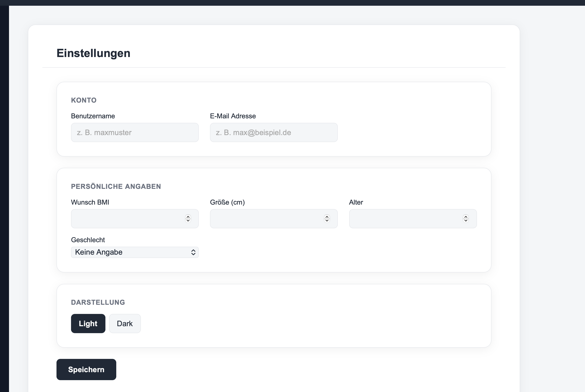

# Readme Settings

Auf der Einstellungsseite werden Konto, persönliche Angaben und Darstellung angepasst und das Passwort geändert. Die Daten werden über die API (Node-RED hinter nginx unter `/api/`) gespeichert, damit sie geräteübergreifend verfügbar sind.



## Felder

### Konto
- Benutzername (mindestens 3 Zeichen)
- E-Mail Adresse

### Persönliche Angaben
- Wunsch BMI (10 – 60)
- Größe in cm (50 – 260)
- Alter (1 – 120)
- Geschlecht (Keine Angabe / Weiblich / Männlich / Divers)

### Darstellung
- Light / Dark Mode, wirkt sofort, auch ohne Speichern

### Passwort ändern
- Aktuelles Passwort, neues Passwort (mindestens 8 Zeichen), Wiederholung
- Option „Passwörter anzeigen“

Alle Felder dürfen leer bleiben. Gefüllte Felder werden vor dem Speichern geprüft, Fehler erscheinen direkt unter dem Feld.

## API

| Methode | Pfad        | Zweck                         |
| ------- | ----------- | ----------------------------- |
| GET     | `/settings` | Einstellungen laden           |
| PUT     | `/settings` | Einstellungen speichern       |
| POST    | `/password` | Passwort ändern (`currentPassword`, `newPassword`) |

Gespeichertes Objekt:

```json
{
  "username": "",
  "email": "",
  "wishBmi": "",
  "height": "",
  "age": "",
  "gender": "",
  "theme": "light"
}
```

Unbekannte Felder vom Server werden ignoriert, ungültige Werte für `theme` und `gender` auf den Standard zurückgesetzt. Antwortet `/password` mit 401 oder 403, gilt das aktuelle Passwort als falsch.
